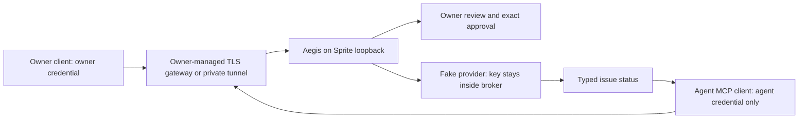

# Owner-controlled Sprite fake-secret workflow

Implemented experiment, October 17, 2026. This mode demonstrates owner/agent authentication, reference-only operation requests, exact owner review, a broker-only generated fake key, and reproducible evidence. It accepts no real credential input. Provisioning, deployment, an externally reachable TLS gateway, operational encrypted storage, and protected application delivery are outside this implementation.

The intended everyday use is to help cooperative agents use credentials safely without copying them into chat, tools, environment variables, or source files. Model vendor and cooperative behavior are not authentication inputs. The same small API also rejects basic attempts to use agent authority as owner authority.

## Ownership and trust



The Sprite, Aegis executable, filesystem, operator credentials, gateway and fake provider are trusted. Agents must have no Sprite exec/file/checkpoint/service/console authority, owner key, or ability to replace broker code/configuration. Provision the Sprite in an organization excluded from agent-connected control-plane credentials. Merely omitting a tool from a prompt does not remove its underlying authority. An agent running under an unrestricted owner account on your administrative workstation can potentially read that workstation's administrative credentials; this demo does not confine that workstation.

Possession of `owner.key` authorizes owner actions. The service does not attest physical human presence or protect an owner credential already available to an agent. This implementation supports one agent principal/token per service instance, not multi-agent identity isolation. Deploy separate instances for distinct independently isolated agent authorities in this experiment.

## Build and privately initialize

On the owner-controlled Linux Sprite, build the checkout with its pinned Rust toolchain:

```sh
cargo build --release --locked --features proxy
./target/release/aegis sprite-demo-init --state-dir /home/sprite/aegis-private
./target/release/aegis sprite-demo-serve --state-dir /home/sprite/aegis-private --listen 127.0.0.1:7979
```

These are operator instructions; the coding agent does not run provisioning or deployment commands. The build needs registry access initially. The binary needs no Rust toolchain at runtime. The client and verifier are native Rust; no interpreter is needed.

Initialization requires a new absolute directory with existing, nonsymlink parents. It writes three private `0600` files under a new `0700` directory:

| File | Custody and purpose |
| --- | --- |
| `owner.key` | Owner client and broker only; 256-bit random bearer credential |
| `agent.key` | Broker and agent client; independently generated 256-bit bearer credential, no owner rights |
| `fake-secret.key` | Broker only; fresh random `AEGIS_FAKE_ONLY_` fixture used to authenticate to the in-process fake provider |

No credential bytes are printed. Never copy the whole state directory to the agent. Transfer only `agent.key` privately into the agent client's own `0600` file. Keep owner-client credentials separate from all agent-accessible workspaces and tools. Initialization refuses an existing destination; an interrupted initialization leaves a partial directory that the owner must inspect and replace with a new destination. File checks reject symlinks, hardlinked files, wrong ownership and incorrect permissions. They assume a trusted owner/filesystem; they are not atomic defenses against a hostile same-UID administrator.

The fake fixture is deliberately plaintext on the owner's disk. Prefix checking limits this demo's supported input; it is not a detector for arbitrary real credentials. Do not replace the fixture with a real key. This is not a vault or an encryption-at-rest implementation. Deleting a fixture cannot erase copies in backups or Sprite checkpoints.

## Transport and service lifecycle

The service refuses nonloopback listeners. HTTP authentication is not encryption. For remote clients, provide an owner-managed TLS gateway/private network path to the loopback listener. The native client accepts HTTPS with standard certificate validation; HTTP is allowed only for literal loopback IP addresses. It rejects redirects, URL credentials/query strings, and ambient proxy configuration.

For Sprite hosting, retain private Sprite URL access. If an outer gateway is needed, it must handle Sprite-level authentication itself and forward the caller's **Aegis** bearer credential to the broker; agents receive only the Aegis credential. Never give agents a general Sprite token to solve HTTP access. The outer gateway must not log Authorization headers or bodies, must enforce connection/header/time/size/rate limits, and must expose only the broker API. No TLS gateway or Sprite authentication relay is bundled here. An operator-only port-forward can validate the app before connecting that gateway. Do not place an administrative tunnel credential on an unrestricted agent host.

Run the foreground command under your chosen supervisor/Sprite Service after you have configured the protected network path. Service installation and TLS configuration are yours to perform. The app holds at most eight active body/handler slots, limits bodies to 16 KiB and body reception to two seconds, and retains at most 128 core requests and 256 sanitized audit events. Incomplete HTTP headers/idle TCP connections and internet-facing abuse need gateway limits; the application bounds are not a public-edge defense.

Authority is deliberately volatile: maximum 20 operations, 600-second idle/1,800-second maximum session, and 15-second prepared-request lifetime inherited from the core. Owner review must finish inside that request lifetime. Pending expiry requires a new request ID and new approval. Session expiry or revocation requires an owner restart for a new session; the server never silently resets a budget. A restart generates a new instance ID and loses all approval receipts, grants, requests, counters and audit history. Persisted role tokens remain valid until the owner rotates them. Broker-instance pinning rejects replay of old handles; never automatically refresh the instance and retry an invocation. Graceful Ctrl-C stops the process; a cold restart/hibernation must be treated as loss of volatile authority.

To revoke the agent immediately, use the owner `revoke` action, then stop the service when appropriate. For token rotation, stop the service, initialize a new private state directory and privately distribute only the new corresponding role token. Never reset authority automatically during retries. Local revocation cannot retract a previously returned result.

## Use the agent client

The following local example assumes an **already protected** tunnel at `127.0.0.1:7979`. For remote use, substitute your verified HTTPS gateway origin. Token paths are private paths on each role's own host, not paths to be shared between roles.

Get the public instance ID using only the agent credential:

```sh
aegis sprite-client --url http://127.0.0.1:7979 --token-file /absolute/agent-client/agent.key --role agent session
```

Copy `instance_id` into `INSTANCE_ID` below. It is a non-secret broker-instance identifier. All CLI calls after session discovery require this explicit pin:

```sh
aegis sprite-client --url http://127.0.0.1:7979 --token-file /absolute/agent-client/agent.key --role agent --instance-id INSTANCE_ID prepare_operation '{"request_id":"demo-1","profile_id":"issue-status","parameters":{"repository_id":4242,"issue_number":7}}'
aegis sprite-client --url http://127.0.0.1:7979 --token-file /absolute/agent-client/agent.key --role agent --instance-id INSTANCE_ID request_approval '{"prepared_request_id":1}'
```

Use the returned numeric handle, rather than assuming it is `1`. Invoking before approval returns `approval_required`; requesting approval only enters pending state. The agent can discover, prepare, request approval, invoke, inspect status and cancel. There is no secret read, arbitrary URL, exec, file access or approval operation.

For an MCP host, launch the provided stdio bridge with this generic configuration, adapting paths and the gateway origin:

```json
{
  "mcpServers": {
    "aegis-sprite-demo": {
      "command": "/absolute/path/to/aegis",
      "args": ["sprite-client", "--url", "https://your-protected-gateway.example", "--token-file", "/absolute/agent-client/agent.key", "--role", "agent", "mcp"]
    }
  }
}
```

The bridge pins the instance at startup, speaks the existing narrow MCP version `2025-11-25`, and exposes six agent tools. It never loads the owner token or fake provider key. A changed broker instance causes failure rather than an automatic retry. Stdio carries protocol output only; errors do not dump HTTP internals. The bridge processes at most 256 frames before exiting. Generic protocol configuration is not a claim of packaged compatibility with a particular agent host.

## Privately review as owner

On the owner's trusted client host, get the current session ID with the owner credential. Then list pending plans or review the request handle supplied by the agent:

```sh
aegis sprite-client --url http://127.0.0.1:7979 --token-file /absolute/owner-client/owner.key --role owner session
aegis sprite-client --url http://127.0.0.1:7979 --token-file /absolute/owner-client/owner.key --role owner --instance-id INSTANCE_ID pending
aegis sprite-client --url http://127.0.0.1:7979 --token-file /absolute/owner-client/owner.key --role owner --instance-id INSTANCE_ID review 1
```

`review` fetches and prints broker-resolved principal, exact request/resource/issue, credential reference/version, policy/profile revisions, effects, output categories, expiry and remaining budget. Typing `approve` sends a random one-use review receipt over the separately authenticated owner route. The broker compares the saved complete approval view in the core's atomic approval operation. Changed bindings/budget, cancellation, expiry or restart invalidate approval; extra rebinding fields are rejected. A receipt grants no owner rights to an agent token. Owner clients can also `cancel`, `revoke`, and request `evidence`. No owner method exports the fixture.

After approval, the agent invokes:

```sh
aegis sprite-client --url http://127.0.0.1:7979 --token-file /absolute/agent-client/agent.key --role agent --instance-id INSTANCE_ID invoke_approved '{"prepared_request_id":1}'
```

Successful output is a run state plus `{ "repository_id": 4242, "issue_number": 7, "state": "open" }`. The fake key is used inside the broker/fake provider. Repeating the same request returns stored state without using the key again. A changed request under the same request ID conflicts. Cancellation returns the retained canceled run; it does not perform an operation.

## API contract

`GET /v1/session` accepts either valid role credential and returns the non-secret current instance ID and fixed limits. It is the only discovery bootstrap. Every POST requires exact `Content-Type: application/json`, one `Authorization: Bearer ...` header and no Origin or query string. Tokens are never accepted as cookies, URL parameters, forwarded role headers or JSON fields.

| Endpoint | Accepted credential | Body |
| --- | --- | --- |
| `POST /v1/agent` | Agent only | `{ "instance_id": "...", "request": <existing version-1 protocol envelope> }` |
| `POST /v1/owner` | Owner only | `{ "instance_id": "...", "action": { "method": "pending/inspect/approve/cancel/revoke/evidence", "params": { ... } } }` |

Owner `inspect`/`cancel` take `prepared_request_id`; `approve` takes only `review_id`; zero-argument actions omit `params`. Unknown fields, duplicate typed fields and unknown methods fail closed. Owner identity is not inferred from the body. Validated operations use the original core, not a second policy engine. Protocol results are `{instance_id,result,error}`; core policy failures use HTTP 200 with `error`, authentication uses 401, stale instance uses 409, malformed input uses 400, unknown paths 404 and wrong methods 405. Errors never echo input/provider/exception text. Responses have `Cache-Control: no-store`.

## Reproduce the evidence

Run on a trusted local test host:

```sh
cargo test --locked --features proxy --test sprite_workflow
```

The native Rust verifier creates temporary role keys and a random fake provider key,
starts the compiled service, and launches a separate MCP client process. It exercises
role authentication, unknown/export routes, exact approval, cancellation, revocation,
concurrent idempotent retries and restart replay. It checks captured MCP and retry
responses for the fixture and role credentials. The owner-only `evidence` API exposes
the authenticated fake-provider call count and bounded audit events. This test writes
no exported evidence reports; its temporary state is removed when it exits.

These checks establish the exercised API behavior, not filesystem, memory or host
administrator isolation. The verifier controls both role credentials. Remote use
still requires a protected gateway and an owner-controlled host. For real credentials,
use the separately documented [secret-injection proxy](secret-proxy.md), not these
synthetic demo routes. See [ADR 0019](adr/0019-owner-controlled-sprite-demo.md).
